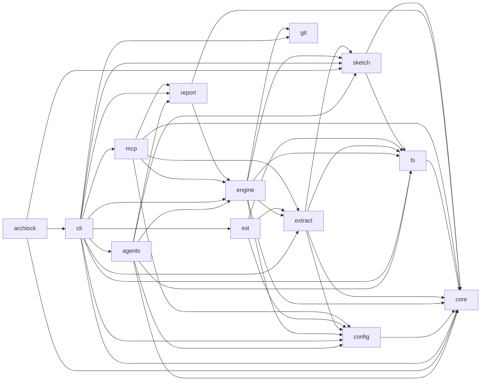

<!-- Generated by archlock. Do not edit by hand: `archlock accept` rewrites this file. -->

# Architecture

This folder is the architecture lockfile of this repository, maintained with [archlock](https://github.com/mcbabel/archlock).
Each `*.arch.py` file sketches one module: which files belong to it, which modules it may depend on,
and its public API. CI runs `archlock check`, so every architecture change is visible and deliberate.

**8,846 lines of code → 736 lines of architecture (12×)**

| Module | Description | Public symbols | Depends on |
|---|---|---|---|
| [agents](./agents.arch.py) | Coding-agent integration for `archlock push`: the work-order prompt, agent adapters and the round loop. | 26 | config, core, engine, fs, report, sketch |
| [archlock](./archlock.arch.py) | Package entry points: the `archlock` binary (src/cli.ts) and the library API (src/index.ts). | 0 | cli, core, sketch |
| [cli](./cli.arch.py) | Command-line layer: argument parsing, prompts and printing. Thin; all logic lives below. | 31 | agents, config, core, engine, extract, fs, git, init, mcp, report, sketch |
| [config](./config.arch.py) | archlock.config.json: defaults, validation with key-specific messages, serialization. | 16 | core |
| [core](./core.arch.py) | Language-neutral architecture model, type canonicalization, rules and the comment-preserving merge. | 55 | – |
| [engine](./engine.arch.py) | The deterministic core as functions: open a workspace, compare code with sketches, compute stats. | 27 | config, core, extract, fs, git, sketch |
| [extract](./extract.arch.py) | Source code → file facts → modules with public APIs, dependency edges and deep imports. | 12 | config, core, fs, sketch |
| [fs](./fs.arch.py) | File system helpers: .gitignore-aware file listing, globs, POSIX paths and the file-hash cache. | 14 | core |
| [git](./git.arch.py) | Read-only git helpers for `archlock diff`: base resolution, temporary worktrees, changed lines. | 9 | – |
| [init](./init.arch.py) | Heuristic module and language detection for `archlock init`. | 4 | config, extract, fs |
| [mcp](./mcp.arch.py) | MCP server (stdio) exposing the architecture and the check to coding agents. Read-only. | 2 | config, core, engine, extract, report |
| [report](./report.arch.py) | Presentation: terminal, JSON, GitHub annotations, Mermaid graph, README and text diffs. | 24 | core, engine |
| [sketch](./sketch.arch.py) | The .arch.py format: parse (web-tree-sitter), render (deterministic), load and write. | 40 | core, fs |

To change the design, edit a sketch and run `archlock push` to let your coding agent update the code.
To adopt an intended code change, run `archlock accept`.
