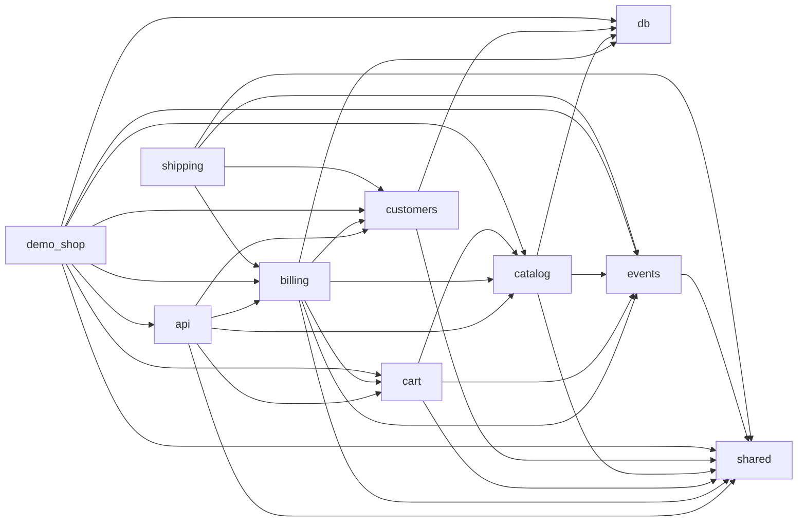

<!-- Generated by archlock. Do not edit by hand: `archlock accept` rewrites this file. -->

# Architecture

This folder is the architecture lockfile of this repository, maintained with [archlock](https://github.com/mcbabel/archlock).
Each `*.arch.py` file sketches one module: which files belong to it, which modules it may depend on,
and its public API. CI runs `archlock check`, so every architecture change is visible and deliberate.

**751 lines of code → 264 lines of architecture (2.8×)**

| Module | Description | Public symbols | Depends on |
|---|---|---|---|
| [api](./api.arch.py) | HTTP API: routes for the catalog, carts, checkout and payment webhooks. | 6 | billing, cart, catalog, customers, shared |
| [billing](./billing.arch.py) | Billing: issue invoices, take payments and record them. | 14 | cart, catalog, customers, db, events, shared |
| [cart](./cart.arch.py) | Shopping carts: line items, discounts, totals and checkout. | 13 | catalog, events, shared |
| [catalog](./catalog.arch.py) | Product catalog: products, search and volume pricing. | 10 | db, events, shared |
| [customers](./customers.arch.py) | Customer accounts and addresses. | 3 | db, shared |
| [db](./db.arch.py) | Storage: an in-memory database with typed tables. | 6 | – |
| [demo_shop](./demo_shop.arch.py) | Application entry point: wires the modules together and starts the server. | 1 | api, billing, cart, catalog, customers, db, events, shared |
| [events](./events.arch.py) | Domain events and the in-process event bus. | 6 | shared |
| [shared](./shared.arch.py) | Shared kernel: money, ids, results and clocks. Depends on nothing. | 20 | – |
| [shipping](./shipping.arch.py) | Shipping: address validation, rates and shipments. | 4 | billing, customers, events, shared |

To change the design, edit a sketch and run `archlock push` to let your coding agent update the code.
To adopt an intended code change, run `archlock accept`.
