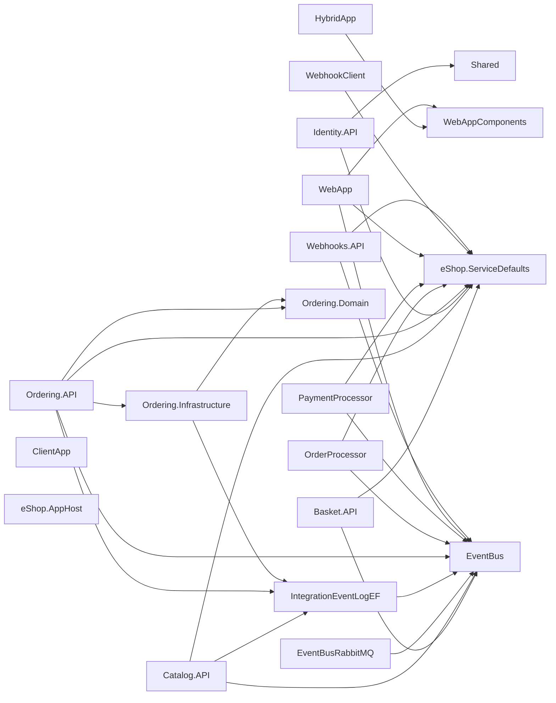

<!-- Generated by archlock. Do not edit by hand: `archlock accept` rewrites this file. -->

# Architecture

This folder is the architecture lockfile of this repository, maintained with [archlock](https://github.com/mcbabel/archlock).
Each `*.arch.py` file sketches one module: which files belong to it, which modules it may depend on,
and its public API. CI runs `archlock check`, so every architecture change is visible and deliberate.

**19,546 lines of code → 3,428 lines of architecture (5.7×)**

| Module | Description | Public symbols | Depends on |
|---|---|---|---|
| [Basket.API](./Basket.API.arch.py) | – | 9 | eShop.ServiceDefaults, EventBus |
| [Catalog.API](./Catalog.API.arch.py) | – | 31 | eShop.ServiceDefaults, EventBus, IntegrationEventLogEF |
| [ClientApp](./ClientApp.arch.py) | – | 148 | – |
| [eShop.AppHost](./eShop.AppHost.arch.py) | – | 0 | – |
| [eShop.ServiceDefaults](./eShop.ServiceDefaults.arch.py) | – | 5 | – |
| [EventBus](./EventBus.arch.py) | – | 7 | – |
| [EventBusRabbitMQ](./EventBusRabbitMQ.arch.py) | – | 4 | EventBus |
| [HybridApp](./HybridApp.arch.py) | – | 13 | WebAppComponents |
| [Identity.API](./Identity.API.arch.py) | – | 60 | eShop.ServiceDefaults, Shared |
| [IntegrationEventLogEF](./IntegrationEventLogEF.arch.py) | – | 6 | EventBus |
| [Ordering.API](./Ordering.API.arch.py) | – | 79 | eShop.ServiceDefaults, EventBus, IntegrationEventLogEF, Ordering.Domain, Ordering.Infrastructure |
| [Ordering.Domain](./Ordering.Domain.arch.py) | – | 22 | – |
| [Ordering.Infrastructure](./Ordering.Infrastructure.arch.py) | – | 10 | IntegrationEventLogEF, Ordering.Domain |
| [OrderProcessor](./OrderProcessor.arch.py) | – | 5 | eShop.ServiceDefaults, EventBus |
| [PaymentProcessor](./PaymentProcessor.arch.py) | – | 5 | eShop.ServiceDefaults, EventBus |
| [Shared](./Shared.arch.py) | – | 1 | – |
| [WebApp](./WebApp.arch.py) | – | 29 | eShop.ServiceDefaults, EventBus, WebAppComponents |
| [WebAppComponents](./WebAppComponents.arch.py) | – | 11 | – |
| [WebhookClient](./WebhookClient.arch.py) | – | 11 | eShop.ServiceDefaults |
| [Webhooks.API](./Webhooks.API.arch.py) | – | 21 | eShop.ServiceDefaults, EventBus |

To change the design, edit a sketch and run `archlock push` to let your coding agent update the code.
To adopt an intended code change, run `archlock accept`.
