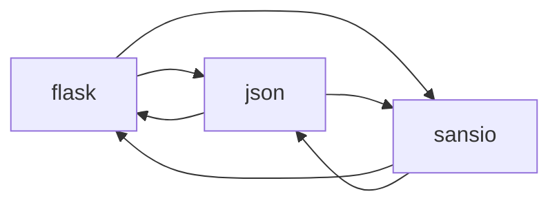

<!-- Generated by archlock. Do not edit by hand: `archlock accept` rewrites this file. -->

# Architecture

This folder is the architecture lockfile of this repository, maintained with [archlock](https://github.com/mcbabel/archlock).
Each `*.arch.py` file sketches one module: which files belong to it, which modules it may depend on,
and its public API. CI runs `archlock check`, so every architecture change is visible and deliberate.

**7,563 lines of code → 542 lines of architecture (14×)**

| Module | Description | Public symbols | Depends on |
|---|---|---|---|
| [flask](./flask.arch.py) | – | 37 | json, sansio |
| [json](./json.arch.py) | – | 5 | flask, sansio |
| [sansio](./sansio.arch.py) | – | 7 | flask, json |

To change the design, edit a sketch and run `archlock push` to let your coding agent update the code.
To adopt an intended code change, run `archlock accept`.
