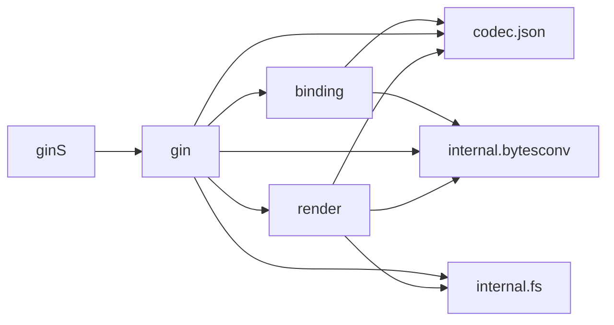

<!-- Generated by archlock. Do not edit by hand: `archlock accept` rewrites this file. -->

# Architecture

This folder is the architecture lockfile of this repository, maintained with [archlock](https://github.com/mcbabel/archlock).
Each `*.arch.py` file sketches one module: which files belong to it, which modules it may depend on,
and its public API. CI runs `archlock check`, so every architecture change is visible and deliberate.

**6,785 lines of code → 630 lines of architecture (11×)**

| Module | Description | Public symbols | Depends on |
|---|---|---|---|
| [binding](./binding.arch.py) | – | 43 | codec.json, internal.bytesconv |
| [codec.json](./codec.json.arch.py) | – | 5 | – |
| [gin](./gin.arch.py) | – | 91 | binding, codec.json, internal.bytesconv, internal.fs, render |
| [ginS](./ginS.arch.py) | – | 26 | gin |
| [internal.bytesconv](./internal.bytesconv.arch.py) | – | 2 | – |
| [internal.fs](./internal.fs.arch.py) | – | 1 | – |
| [render](./render.arch.py) | – | 26 | codec.json, internal.bytesconv, internal.fs |

To change the design, edit a sketch and run `archlock push` to let your coding agent update the code.
To adopt an intended code change, run `archlock accept`.
