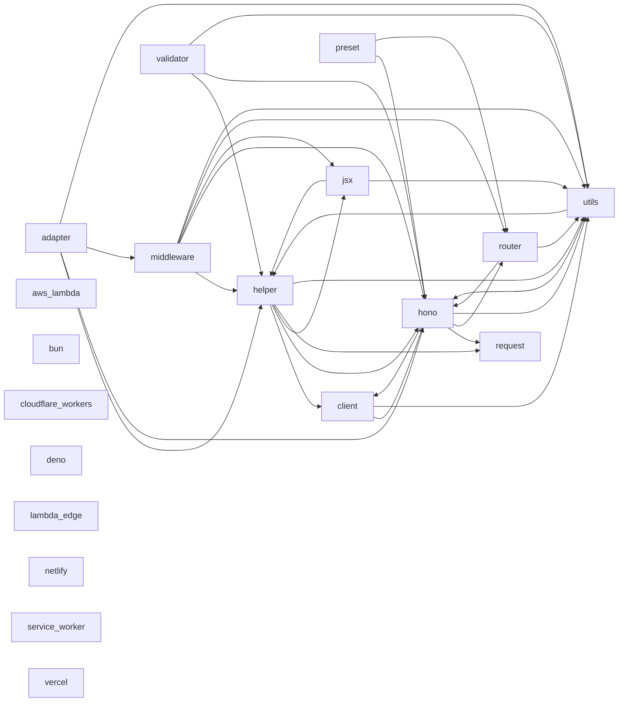

<!-- Generated by archlock. Do not edit by hand: `archlock accept` rewrites this file. -->

# Architecture

This folder is the architecture lockfile of this repository, maintained with [archlock](https://github.com/mcbabel/archlock).
Each `*.arch.py` file sketches one module: which files belong to it, which modules it may depend on,
and its public API. CI runs `archlock check`, so every architecture change is visible and deliberate.

**25,971 lines of code → 1,743 lines of architecture (15×)**

| Module | Description | Public symbols | Depends on |
|---|---|---|---|
| [adapter](./adapter.arch.py) | – | 54 | helper, hono, middleware, utils |
| [aws_lambda](./aws_lambda.arch.py) | – | 10 | – |
| [bun](./bun.arch.py) | – | 10 | – |
| [client](./client.arch.py) | – | 11 | hono, utils |
| [cloudflare_workers](./cloudflare_workers.arch.py) | – | 3 | – |
| [deno](./deno.arch.py) | – | 5 | – |
| [helper](./helper.arch.py) | – | 111 | client, hono, jsx, request, utils |
| [hono](./hono.arch.py) | – | 18 | client, request, router, utils |
| [jsx](./jsx.arch.py) | – | 60 | helper, utils |
| [lambda_edge](./lambda_edge.arch.py) | – | 7 | – |
| [middleware](./middleware.arch.py) | – | 76 | helper, hono, jsx, router, utils |
| [netlify](./netlify.arch.py) | – | 2 | – |
| [preset](./preset.arch.py) | – | 1 | hono, router |
| [request](./request.arch.py) | – | 1 | – |
| [router](./router.arch.py) | – | 24 | hono, utils |
| [service_worker](./service_worker.arch.py) | – | 2 | – |
| [utils](./utils.arch.py) | – | 150 | helper, hono |
| [validator](./validator.arch.py) | – | 3 | helper, hono, utils |
| [vercel](./vercel.arch.py) | – | 2 | – |

To change the design, edit a sketch and run `archlock push` to let your coding agent update the code.
To adopt an intended code change, run `archlock accept`.
