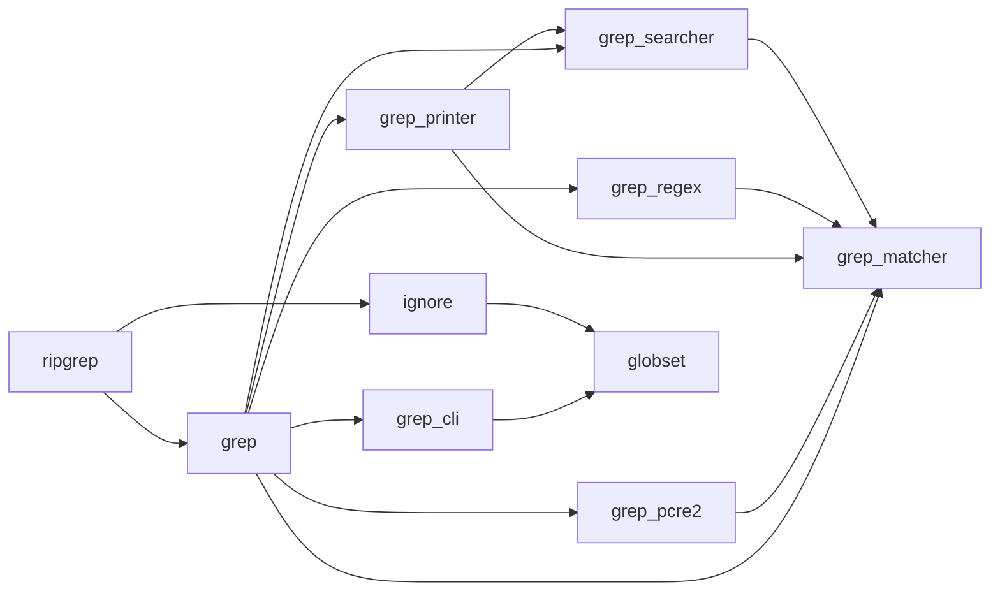

<!-- Generated by archlock. Do not edit by hand: `archlock accept` rewrites this file. -->

# Architecture

This folder is the architecture lockfile of this repository, maintained with [archlock](https://github.com/mcbabel/archlock).
Each `*.arch.py` file sketches one module: which files belong to it, which modules it may depend on,
and its public API. CI runs `archlock check`, so every architecture change is visible and deliberate.

**43,627 lines of code → 886 lines of architecture (49×)**

| Module | Description | Public symbols | Depends on |
|---|---|---|---|
| [globset](./globset.arch.py) | – | 9 | – |
| [grep](./grep.arch.py) | – | 0 | grep_cli, grep_matcher, grep_pcre2, grep_printer, grep_regex, grep_searcher |
| [grep_cli](./grep_cli.arch.py) | – | 29 | globset |
| [grep_matcher](./grep_matcher.arch.py) | – | 8 | – |
| [grep_pcre2](./grep_pcre2.arch.py) | – | 5 | grep_matcher |
| [grep_printer](./grep_printer.arch.py) | – | 23 | grep_matcher, grep_searcher |
| [grep_regex](./grep_regex.arch.py) | – | 5 | grep_matcher |
| [grep_searcher](./grep_searcher.arch.py) | – | 14 | grep_matcher |
| [ignore](./ignore.arch.py) | – | 22 | globset |
| [ripgrep](./ripgrep.arch.py) | – | 0 | grep, ignore |

To change the design, edit a sketch and run `archlock push` to let your coding agent update the code.
To adopt an intended code change, run `archlock accept`.
