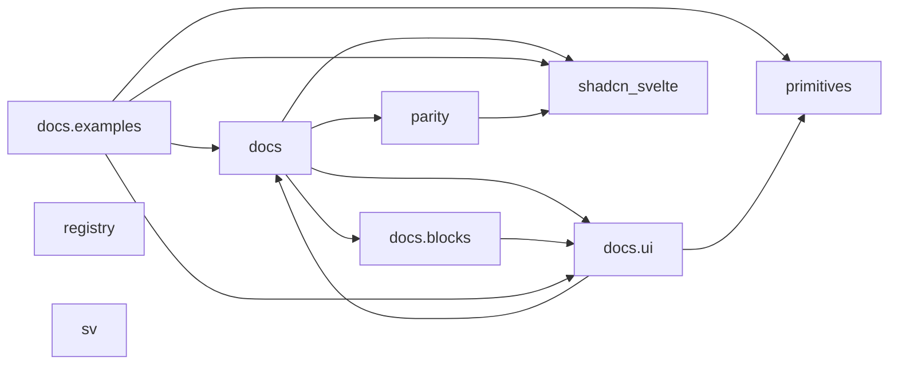

<!-- Generated by archlock. Do not edit by hand: `archlock accept` rewrites this file. -->

# Architecture

This folder is the architecture lockfile of this repository, maintained with [archlock](https://github.com/mcbabel/archlock).
Each `*.arch.py` file sketches one module: which files belong to it, which modules it may depend on,
and its public API. CI runs `archlock check`, so every architecture change is visible and deliberate.

**133,461 lines of code → 3,011 lines of architecture (44×)**

| Module | Description | Public symbols | Depends on |
|---|---|---|---|
| [docs](./docs.arch.py) | – | 566 | docs.blocks, docs.ui, parity, shadcn_svelte |
| [docs.blocks](./docs.blocks.arch.py) | Larger compositions such as dashboards, sidebars and login pages. | 229 | docs.ui |
| [docs.examples](./docs.examples.arch.py) | Usage examples of each component, shown on the docs pages. | 213 | docs, docs.ui, primitives, shadcn_svelte |
| [docs.ui](./docs.ui.arch.py) | The components users copy into their apps (npx shadcn-svelte add). | 474 | docs, primitives |
| [parity](./parity.arch.py) | – | 45 | shadcn_svelte |
| [primitives](./primitives.arch.py) | – | 237 | – |
| [registry](./registry.arch.py) | – | 1 | – |
| [shadcn_svelte](./shadcn_svelte.arch.py) | – | 173 | – |
| [sv](./sv.arch.py) | – | 1 | – |

To change the design, edit a sketch and run `archlock push` to let your coding agent update the code.
To adopt an intended code change, run `archlock accept`.
