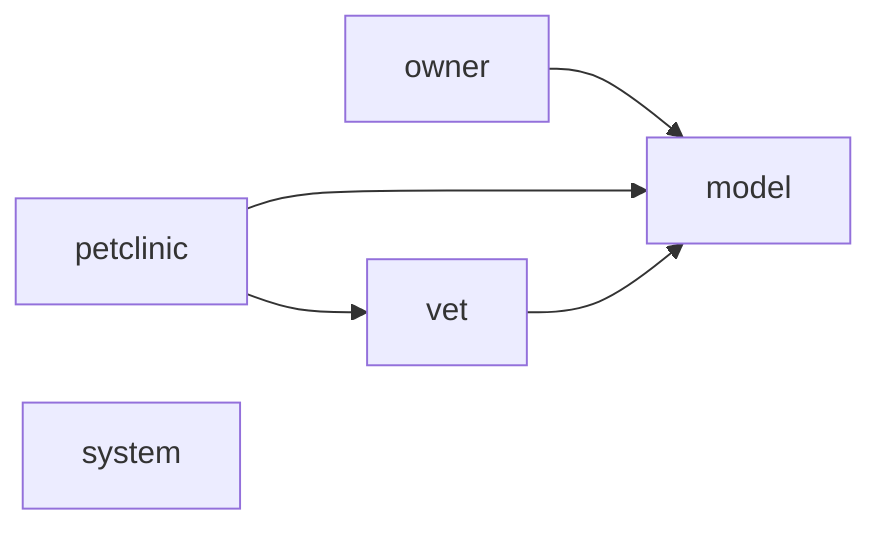

<!-- Generated by archlock. Do not edit by hand: `archlock accept` rewrites this file. -->

# Architecture

This folder is the architecture lockfile of this repository, maintained with [archlock](https://github.com/mcbabel/archlock).
Each `*.arch.py` file sketches one module: which files belong to it, which modules it may depend on,
and its public API. CI runs `archlock check`, so every architecture change is visible and deliberate.

**1,644 lines of code → 95 lines of architecture (17×)**

| Module | Description | Public symbols | Depends on |
|---|---|---|---|
| [model](./model.arch.py) | – | 3 | – |
| [owner](./owner.arch.py) | – | 8 | model |
| [petclinic](./petclinic.arch.py) | – | 2 | model, vet |
| [system](./system.arch.py) | – | 1 | – |
| [vet](./vet.arch.py) | – | 4 | model |

To change the design, edit a sketch and run `archlock push` to let your coding agent update the code.
To adopt an intended code change, run `archlock accept`.
