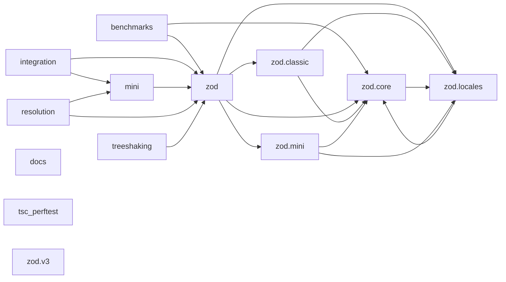

<!-- Generated by archlock. Do not edit by hand: `archlock accept` rewrites this file. -->

# Architecture

This folder is the architecture lockfile of this repository, maintained with [archlock](https://github.com/mcbabel/archlock).
Each `*.arch.py` file sketches one module: which files belong to it, which modules it may depend on,
and its public API. CI runs `archlock check`, so every architecture change is visible and deliberate.

**45,221 lines of code → 5,824 lines of architecture (7.8×)**

| Module | Description | Public symbols | Depends on |
|---|---|---|---|
| [benchmarks](./benchmarks.arch.py) | – | 39 | zod, zod.core |
| [docs](./docs.arch.py) | – | 88 | – |
| [integration](./integration.arch.py) | – | 16 | mini, zod |
| [mini](./mini.arch.py) | – | 0 | zod |
| [resolution](./resolution.arch.py) | – | 1 | mini, zod |
| [treeshaking](./treeshaking.arch.py) | – | 4 | zod |
| [tsc_perftest](./tsc_perftest.arch.py) | – | 6 | – |
| [zod](./zod.arch.py) | – | 0 | zod.classic, zod.core, zod.locales, zod.mini |
| [zod.classic](./zod.classic.arch.py) | Zod 4 classic API: chainable methods like z.string().min(1) (what import "zod" gives you). | 321 | zod.core, zod.locales |
| [zod.core](./zod.core.arch.py) | Zod 4 core: the schema engine both APIs build on (zod/v4/core). | 861 | zod.locales |
| [zod.locales](./zod.locales.arch.py) | Error messages in many languages (zod/locales). | 63 | zod.core |
| [zod.mini](./zod.mini.arch.py) | Zod 4 mini API: tree-shakable functions like z.string().check(z.minLength(1)) (zod/mini). | 277 | zod.core, zod.locales |
| [zod.v3](./zod.v3.arch.py) | Zod 3, still shipped for compatibility (zod/v3). | 256 | – |

To change the design, edit a sketch and run `archlock push` to let your coding agent update the code.
To adopt an intended code change, run `archlock accept`.
